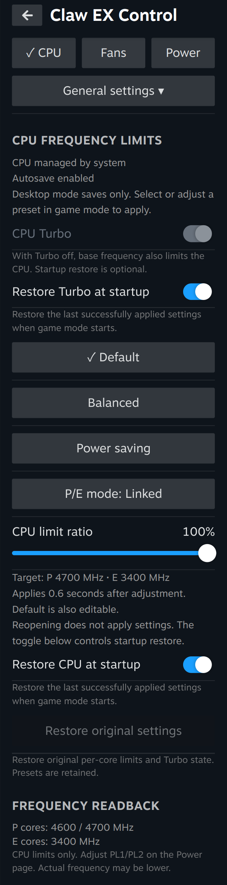
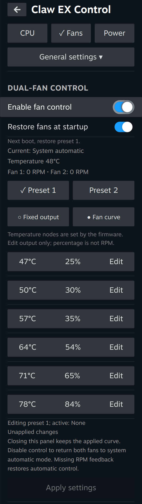
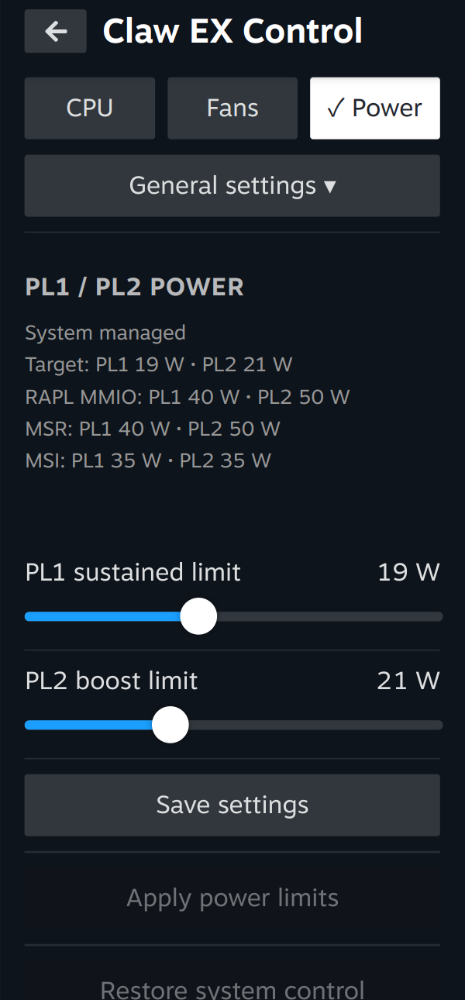

# Claw EX Control

A Decky Loader plugin for CPU frequency, linked dual-fan and PL1/PL2 power control on MSI Claw EX handhelds.

## Control panels

| CPU frequency and Turbo | Dual-fan curve | Package power limits |
| --- | --- | --- |
| [](docs/screenshots/cpu.png) | [](docs/screenshots/fans.png) | [](docs/screenshots/power.png) |

Captured from Claw EX Control in Steam Big Picture on the MSI Claw 8 EX. Select an image to view it at full size.

## Reference hardware

The following values were read on the CachyOS handheld used to develop version 0.6.6. Check the model and board before installing.

| Component | Observed configuration |
| --- | --- |
| Handheld | MSI Claw 8 EX AI+ CG3EM Launch Pack, board `MS-1T91` |
| Processor | Intel Arc G3 Extreme, 10 cores and 10 threads |
| Frequency policies | 2 policies in the P group and 8 in the E group, one per logical CPU |
| Hardware ceilings | P group: one core at 4,600 MHz and one at 4,700 MHz. E group: 3,400 MHz per core |
| CPU driver | `intel_pstate` in active mode |
| Reference system | CachyOS, kernel `7.3.3-1-cachyos-deckify`, BIOS `E1T91IMS.10D` |
| Control interfaces | Linux cpufreq for CPU limits, Intel RAPL for package power, MSI WMI hwmon for both fans |

The backend checks the board and discovers P/E groups from the kernel's CPU masks. Other boards and policy layouts have not been validated.

## Configuring CPU frequency

Open **Claw EX Control → CPU** in Steam game mode. Pick **Default**, **Balanced** or **Power saving**. All three are editable profiles. Selecting a saved profile applies it. For an empty profile, move a slider to save its first settings.

- **Linked** scales both groups by the selected percentage of their respective ceilings and rounds each result to 100 MHz. For example, with the reference ceilings above, 70% requests 3,300 MHz for P and 2,400 MHz for E.
- **Separate** gives P and E their own sliders in 100 MHz steps. Each policy keeps its individual ceiling. A 4,700 MHz P request can therefore read back as 4,600 MHz on one core and 4,700 MHz on the other.
- **CPU Turbo** controls boost independently. Disabling Turbo can reduce the attainable frequency below a configured cap. The frequency readback shows the policy ceiling. Actual clock speed varies with workload.
- **Restore original settings** returns the CPU limits and plugin-managed Turbo state to their pre-control values while keeping saved profiles. Use this button to hand control back after editing **Default**.

Slider edits apply about 0.6 seconds after the last change in game mode. In desktop mode, edits save the profile for later use. CPU caps and package power limits have separate controls. For startup, first apply the settings you want, then enable the corresponding restore switch. CPU frequency, Turbo, package power and fans each have their own opt-in switch.

## Installation

Download the full `decky-claw-ex-control-<version>-install.tar.gz` archive for your chosen [release](https://github.com/Hardwell-L/decky-claw-ex-control/releases). Extract it and run the following command from the extracted directory.

```sh
sudo python3 scripts/install.py
```

This installs both the Decky frontend and a root systemd controller. The current installer targets user `deck` and `/home/deck/homebrew/plugins`. It validates hashes, backs up a read-only hardware snapshot and starts idle. It refuses an existing installation or recovery state rather than overwriting it. The Decky ZIP alone does **not** install the controller.

Reload Decky after installation. Hardware application requires an independent Steam gaming session; desktop mode supports configuration editing. The internal service/socket remain named `claw-cpu-control` for continuity.

### Existing local versions

Do not install alongside `Claw CPU Control`. Restore CPU, fan and power settings first and use the old version's uninstall script. Keep `/var/lib/claw-cpu-control` backups; the installer intentionally refuses to overwrite retained state. Migration of existing local installations requires inspecting and archiving that state first. No general-purpose automatic upgrade or deletion of recovery records is provided in this release. The `scripts/update-*.py` files are historical, machine-specific migration tools for the old plugin directory and specific package versions; they are preserved as development history, not included in release archives, and must not be used as the current installer.

## Power controls

The Power page uses the RAPL package interface: MMIO first, MSR only when MMIO is absent. Constraints are discovered by their `long_term` / `short_term` names. MSI firmware values are diagnostic only; there is no MSI write fallback and no requirement to select Steam's custom performance profile. The conservative MS-1T91 application range remains PL1 8–35 W and PL2 9–45 W, with PL2 ≥ PL1. RAPL's nominal `max_power_uw` is not interpreted as a writable ceiling.

Slider changes save and apply after 400 ms in game mode; desktop edits only save. Requests are serialized and obsolete queued automatic changes are discarded. The UI separates target values, selected RAPL readbacks, MSR and MSI diagnostics. A lower MSR constraint is reported without raising it. Immediate readback is followed by checks at approximately 1 and 5 seconds; these verify configured limits, not actual package consumption. External RAPL changes release ownership without a write loop. No power service is stopped.

Opt-in startup/resume restoration waits for the interface, primary limits and MSR readings to remain stable for 10 seconds, then attempts the last successfully applied pair once per lifecycle. Game-mode exit, heartbeat loss and resume release existing ownership. Restore returns the exact pre-control limits, including fractional watts and limits above the UI range, only while the interface and values still match the transaction. Partial failures attempt rollback. Legacy MSI journals are archived without replaying their values into RAPL.

Version 0.6.6 was installed on the reference handheld and read all three interfaces. During the installation check, MMIO and MSR each reported 40 W / 50 W and MSI reported 35 W / 35 W. These are observations from that session. Sustained application and restoration of a power limit in game mode remain to be verified on hardware.

## Configuring the dual fans

Open **Fans**, choose one of the two presets and enable fan control. Choose **Fixed output** to send the same output percentage at all six points, or **Fan curve** to edit the output for each firmware temperature point. Both fans receive the selected outputs and keep their own temperature nodes. The panel reports RPM separately for each fan.

Editing saves a draft. Select **Apply settings** to activate it. Disabling fan control returns both fans to firmware automatic mode. If RPM feedback is missing after the ten-second grace period, the controller attempts to restore automatic control.

Apply a fan plan successfully, then enable **Restore fans at startup**. On the next boot, the controller waits for game mode and a live Decky heartbeat before applying that successful plan. Unapplied drafts do not change the boot plan. Each boot allows one automatic attempt; failure or manual restoration does not cause repeated application. Turning the option off cancels future automatic application without changing the current curve.

Closing the panel retains active control. A missing panel heartbeat alone does not cancel an active fan curve; backend RPM monitoring continues. Exiting game mode, plugin unload or normal service shutdown attempts restoration. A crash or power loss cannot guarantee immediate restoration. Recovery records are retained on ambiguous state or external changes; the plugin does not continuously fight another controller.

## Restore / uninstall

```sh
python3 /usr/local/lib/claw-cpu-control/control.py status
python3 /usr/local/lib/claw-cpu-control/control.py fan-status
python3 /usr/local/lib/claw-cpu-control/control.py power-status
python3 /usr/local/lib/claw-cpu-control/control.py restore
python3 /usr/local/lib/claw-cpu-control/control.py fan-restore
python3 /usr/local/lib/claw-cpu-control/control.py power-restore
sudo python3 scripts/uninstall.py
```

Uninstall refuses to proceed if recovery is incomplete. Settings and recovery history are retained. Do not delete transaction files to bypass a recovery error.

## Development

```sh
pnpm install --frozen-lockfile --ignore-scripts
pnpm typecheck
pnpm test:ui
python3 -m unittest discover -s tests -v
pnpm build
python3 scripts/package.py
```

Python uses the standard library. Node dependencies are locked. Release archives and checksums are created under `release/`. The backend only exposes fixed operations through a restricted Unix socket, not arbitrary shell commands or filesystem writes. The installer grants the service write access to the CPU controls, the discovered fan hwmon subtree and the selected RAPL package's two power-limit files.

Version 0.6.6 passed 134 backend tests, six frontend test suites, TypeScript checks and the Rollup build.

## Language

The interface defaults to automatic language selection: Steam language first, then system locale. Chinese Steam/system locales use Simplified Chinese; all others use English. The top Language button cycles Auto / Simplified Chinese / English and saves the preference in Steam browser local storage. Known labels/status text are translated; unknown diagnostic messages retain their original text. Language changes do not apply hardware settings.

## License

[MIT](LICENSE)
